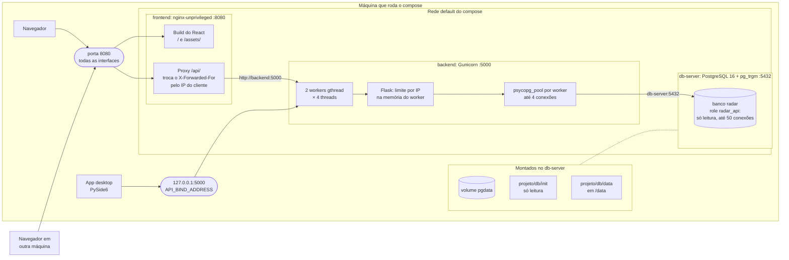
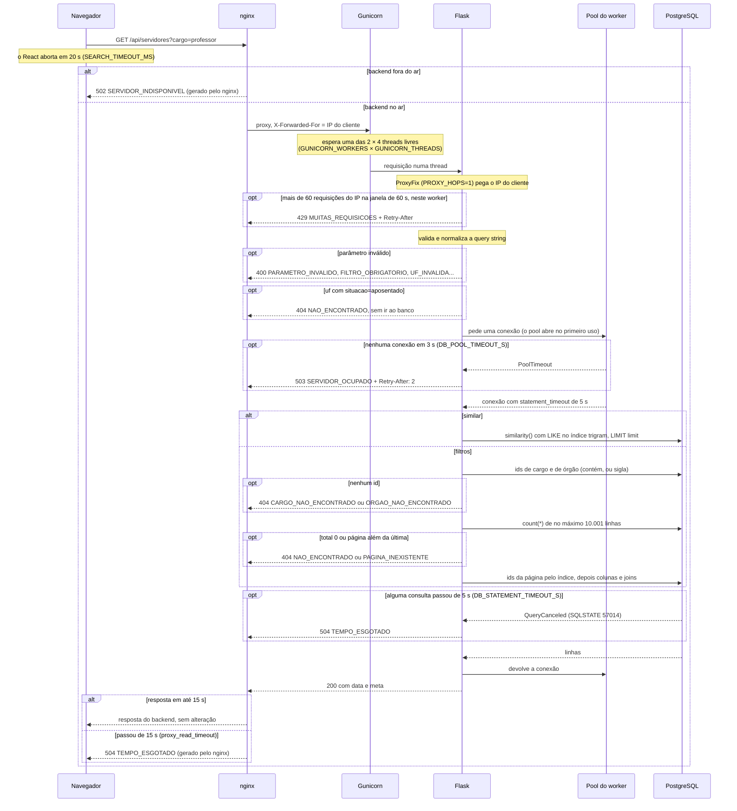
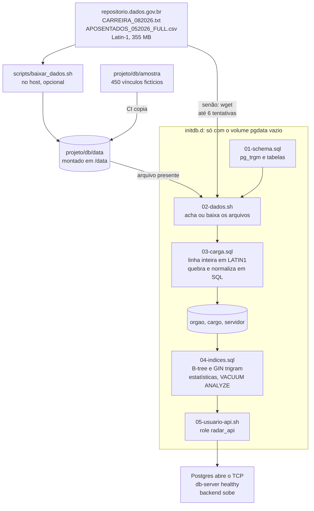
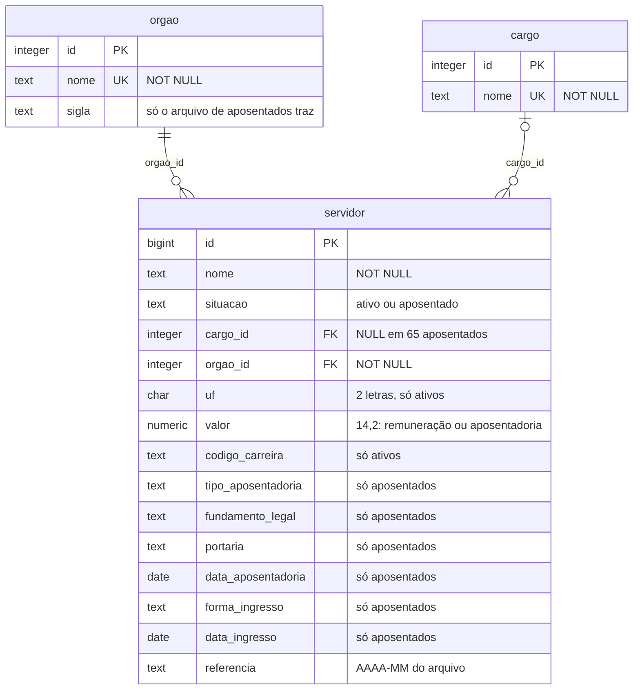
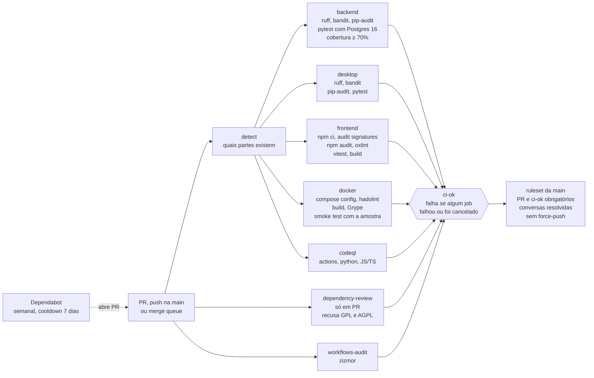

# Arquitetura

Como o Radar Público é montado, por onde passa uma busca, como os dados chegam ao banco e por que cada peça é assim. Os detalhes ficam em [`api.md`](api.md) (contrato da API), [`banco.md`](banco.md) (modelo, carga, índices e pool) e [`dados.md`](dados.md) (arquivos de origem). Os limites e como ajustá-los por máquina estão no [README](../README.md#limites-e-ajuste-por-máquina).

O documento descreve a `main`. O que ainda depende de issue aberta aparece com o número dela. Os diagramas são Mermaid, que o GitHub desenha a partir do código: para mudar um, edite o bloco neste arquivo.

## Visão geral

| Peça | Tecnologia | Porta | Papel |
|---|---|---|---|
| `frontend` | nginx-unprivileged 1.31.7 servindo o build do React 19 (Vite) | 8080, aberta para a rede | Site e proxy de `/api/` para o backend. É a entrada pública |
| `backend` | Python 3.13, Flask 3.1, Gunicorn 26 | 5000, só em `127.0.0.1` (`API_BIND_ADDRESS`) | API JSON de [`api.md`](api.md) |
| `db-server` | PostgreSQL 16 + `pg_trgm` | 5432, só dentro da rede do compose | Banco carregado na primeira subida |
| Desktop | PySide6 6.12, HTTP com `urllib` | — | Cliente da mesma API, fora do compose |

## Contêineres e rede

- **Quem fala com quem.** Os três serviços ficam na rede `default` do compose (`projeto_default`) e se acham pelo nome do serviço. O navegador só fala com o nginx (porta 8080): o site e a API saem da mesma origem, sem CORS, e a CSP (`security-headers.conf`) só permite a própria origem. O nginx repassa `/api/` para `http://backend:5000` sem mudar o caminho. O backend fala com `db-server:5432` como `radar_api` (`DATABASE_URL`, montada pelo compose). O banco não publica porta no host.
- **Porta 5000.** Publicada só em `127.0.0.1`: quem chama a 5000 direto pode mandar um `X-Forwarded-For` falso e escapar do limite por IP. De outra máquina, a API é acessada pelo nginx, em `http://<máquina>:8080/api`. `API_BIND_ADDRESS=0.0.0.0` no `.env` abre a porta para a rede.
- **Desktop.** Usa `http://localhost:5000/api` por padrão (`--api-url` ou `RADAR_API_URL` mudam), ou seja, fala direto com o backend, sem o nginx. Para usar de outra máquina, aponte para `http://<máquina>:8080/api`. Tempo limite de 20 s por chamada (`TEMPO_LIMITE_S` em `radar_desktop/api.py`).
- **DNS.** O nginx resolve `backend` pelo DNS do Docker (`127.0.0.11`) a cada requisição, com cache de 10 s e `resolver_timeout 2s`. Assim ele sobe antes do backend e acompanha um container recriado. O custo é não ter keepalive com o Gunicorn: cada requisição abre uma conexão nova.
- **Ordem de subida.** O backend só sobe com o `db-server` saudável (`depends_on: service_healthy`); o frontend espera o backend apenas iniciar.
- **Privilégios.** Os três serviços rodam com `no-new-privileges`. O backend roda como `appuser` (uid 1000) e o nginx como `nginx`; o código e o site pertencem ao root, e o processo só lê.

| Serviço | Healthcheck | Intervalo, timeout, tentativas |
|---|---|---|
| `db-server` | `pg_isready -h 127.0.0.1` (TCP). Durante a carga o Postgres só escuta no socket local, então o serviço só fica saudável com os dados carregados | 10 s, 5 s, 6, com `start_period` de 20 min |
| `backend` | `healthcheck.py`: `GET /api/health` em `127.0.0.1:5000`, com 2 s de espera. A rota não toca no banco e não passa pelo limite por IP | 10 s, 3 s, 3 |
| `frontend` | `wget http://127.0.0.1:8080/` | 10 s, 3 s, 3 |

Em desenvolvimento, `npm run dev` sobe o Vite na porta 5173 com proxy de `/api` para `http://localhost:5000` (`API_PROXY_TARGET` muda o destino).

## Fluxo de uma busca

Exemplo: `GET /api/servidores?cargo=professor` pelo site. Toda resposta do Flask, inclusive os erros, volta pelo nginx sem alteração (`proxy_intercept_errors` desligado). O nginx só gera as próprias respostas quando o backend não atende.

O limite de cada etapa, com a variável que o controla:

| Etapa | Limite padrão | Onde muda | Quando estoura |
|---|---|---|---|
| Navegador | 20 s por busca | `SEARCH_TIMEOUT_MS` em `projeto/frontend/src/api.ts` (desktop: `TEMPO_LIMITE_S`) | A tela avisa que a API não respondeu |
| nginx | conexão 5 s, leitura e envio 15 s | `proxy_connect_timeout`, `proxy_read_timeout`, `proxy_send_timeout` em `nginx.conf` | 504 `TEMPO_ESGOTADO`; backend inacessível dá 502 `SERVIDOR_INDISPONIVEL` |
| Gunicorn | 2 workers × 4 threads = 8 buscas ao mesmo tempo | `GUNICORN_WORKERS`, `GUNICORN_THREADS` | As outras esperam na fila do worker (até 1.000 conexões por worker, padrão do Gunicorn) |
| Gunicorn | worker sem sinal de vida por 30 s é reiniciado | `GUNICORN_TIMEOUT` | Ver [Limites conhecidos](#limites-conhecidos) |
| Limite por IP | 60 requisições a cada 60 s, por worker | `RATE_LIMIT_REQUESTS` (`0` desliga), `RATE_LIMIT_WINDOW_S`, `PROXY_HOPS` | 429 `MUITAS_REQUISICOES` com `Retry-After` até a janela virar |
| Validação | textos de 2 a 100 caracteres, `per_page` e `limit` até 100 | `app/search_params.py` | 400, antes de qualquer consulta |
| Pool | 4 conexões por worker (= threads); workers × pool ≤ 45 | `DB_POOL_MAX`, `DB_POOL_MIN` (1) | Espera até `DB_POOL_TIMEOUT_S` (3 s), depois 503 `SERVIDOR_OCUPADO` com `Retry-After: 2` |
| Conexão nova | 5 s para conectar | `DB_CONNECT_TIMEOUT_S` | O pool tenta de novo; quem espera recebe o 503 acima |
| Consulta | 5 s cada | `DB_STATEMENT_TIMEOUT_S` (sessão); o role tem o seu, `POSTGRES_API_STATEMENT_TIMEOUT` | O banco cancela e a API responde 504 `TEMPO_ESGOTADO` |
| Banco | 50 conexões para `radar_api` | `CONNECTION LIMIT` em `05-usuario-api.sh` | 45 ficam para o backend e 5 de folga para psql, healthcheck e manutenção |
| Resultado | contagem até 10.000; `similar` até `limit` (100) | `MAX_TOTAL` em `app/search_params.py` | `total_exato: false` e só existem as páginas até o 10.000º resultado |

`DB_POOL_MIN`, `DB_CONNECT_TIMEOUT_S` e as outras `GUNICORN_*` (`GUNICORN_MAX_REQUESTS`, `GUNICORN_KEEPALIVE`...) são lidas pelo código, mas o compose não as repassa ao container; as da tabela do README, sim.

Os tempos ficam em ordem: 5 s no banco < 15 s do nginx < 20 s do frontend < 30 s do Gunicorn. Uma busca com filtros faz até 4 consultas (cargo, órgão, contagem e página) e pode esperar 3 s pelo pool, então o pior caso passa dos 15 s e quem responde é o nginx.

Com `similar`, a busca é uma consulta só, sem contagem nem paginação, ordenada pela semelhança; sem resultado, responde 404 `NAO_ENCONTRADO`. Na `main` ela ignora `cargo`, `orgao`, `uf` e `situacao` (issue #52).

## Fluxo dos dados

1. **Arquivos.** `02-dados.sh` usa `/data/<arquivo>` se ele existir e não estiver vazio. Senão, baixa do dados.gov.br com `wget`, em até 6 tentativas com espera crescente (5 s, 10 s, ... 30 s), e grava em `/data` (fica no host) ou, se `/data` não aceitar escrita, no volume do banco. `scripts/baixar_dados.sh` faz o mesmo download pela rede do host, que costuma ser mais confiável. O CI usa a amostra sintética de `projeto/db/amostra` (300 ativos e 150 aposentados fictícios, gerados por `scripts/gerar_amostra.py`), no mesmo formato da fonte. Formato completo em [`dados.md`](dados.md).
2. **Carga** (`03-carga.sql`). Cada linha entra inteira numa tabela temporária (`COPY` com delimitador e aspas em bytes que não aparecem nos arquivos, `ENCODING 'LATIN1'`) e é quebrada em SQL, para que `;` e `"` dentro dos valores não quebrem a importação. Título, cabeçalho e linhas de total são descartados; a portaria das 123 linhas com `;` é remontada. Nomes, cargos e órgãos são normalizados como a API normaliza a entrada (maiúsculas, sem acento, espaços simples); `1.234,56` vira número e `DDMMYYYY` vira data. `orgao` e `cargo` saem dos valores distintos dos dois arquivos, e `servidor` recebe ativos (`referencia` `2026-08`) e aposentados (`2026-05`).
3. **Índices** (`04-indices.sql`), criados depois da carga, que é bem mais rápida sem eles:

   | Índice | Tipo | Para |
   |---|---|---|
   | `servidor (nome, id)` | B-tree | nome exato e ordenação da listagem |
   | `servidor (cargo_id, nome, id)`, `(orgao_id, nome, id)`, `(uf, nome, id) WHERE uf IS NOT NULL` | B-tree | filtro já na ordem da listagem, sem ordenar milhares de linhas |
   | `servidor.nome` | GIN `gin_trgm_ops` | `similar` e padrões com `%` |
   | `cargo.nome`, `orgao.nome` | GIN `gin_trgm_ops` | resolver `cargo` e `orgao` por "contém" |
   | `orgao (upper(sigla))` | B-tree | sigla do órgão |

   `SET STATISTICS 1000` em `orgao_id` e `3000` em `cargo_id` corrigem a estimativa de órgãos e cargos raros (de 1,5 a 2 s para 4 a 20 ms), e o `VACUUM ANALYZE` no fim deixa as estatísticas prontas. Os planos e tempos medidos estão em [`banco.md`](banco.md#índices-e-desempenho).
4. **Usuário da API** (`05-usuario-api.sh`). `radar_api` com `SELECT` em todas as tabelas, transações somente leitura por padrão, `statement_timeout` de 5 s e `CONNECTION LIMIT 50`.
5. **Pronto.** Só ao fim dos scripts o Postgres passa a escutar em TCP. O healthcheck passa, e o backend, que depende do banco saudável, sobe. Com os arquivos já baixados, isso levou 98 s no notebook de desenvolvimento; com a amostra, a carga leva cerca de 3 s.

Para recarregar do zero: `docker compose down -v && docker compose up --build`.

## Modelo de dados

Cada linha de `servidor` é um vínculo, ativo ou aposentado, na mesma tabela porque a API busca os dois juntos. Os ids são `GENERATED ALWAYS AS IDENTITY`. Detalhes em [`banco.md`](banco.md#modelo).

## CI/CD e cadeia de suprimentos

- **`ci-ok`** é o único check obrigatório. Depende de todos os jobs (inclusive `detect`) e só falha com `failure` ou `cancelled`: job pulado, como o `dependency-review` num push, não reprova.
- **Smoke test** (job `docker`): copia `projeto/db/amostra` para `projeto/db/data`, sobe o compose com `--wait` (até 300 s) e chama `localhost:5000/api/health`, `localhost:8080/` e `localhost:8080/api/health`.
- **Licenças:** o `dependency-review` recusa dependências GPL-3.0 e AGPL-3.0; a exceção é só `pyside6-essentials` e `shiboken6`, usados sob a opção LGPL-3.0 do Qt for Python.
- **Fixação:** actions por SHA de commit, imagens base por digest, versões exatas em `requirements.txt` e `package.json`, ferramentas de CI com hash (`.github/ci/requirements.txt`). Todos os workflows começam com `permissions: {}`.
- **Dependabot:** actions, pip (`projeto/backend` e `.github/ci`), npm (`projeto/frontend`), Dockerfiles e compose, toda semana, esperando 7 dias depois de cada versão publicada.
- Fora do `ci.yml`, o `scorecard.yml` roda o OpenSSF Scorecard a cada push na `main` e toda segunda-feira.

## Decisões e alternativas

| Decisão | Por quê | Alternativa descartada |
|---|---|---|
| Limite por IP próprio (`app/rate_limit.py`): janela fixa em memória, com lock entre as threads | Uma classe pequena faz o necessário, sem dependência nova para auditar no `pip-audit` e no scan da imagem. Responde no formato do contrato, com `Retry-After`, e libera `/api/health` | flask-limiter: traria 6 pacotes (flask-limiter e mais limits, deprecated, wrapt, packaging, ordered-set) e, sem Redis, também contaria por worker |
| Sem Redis | Seria mais um serviço no compose só para o contador. O limite por worker já barra um script em laço (429 em segundos) e o teto real está documentado | Redis compartilhado entre os workers, com limite exato por IP |
| Pool `psycopg_pool` por worker, criado fechado e aberto no primeiro uso | Nasce dentro do worker, depois do fork: threads e sockets do pool não são divididos entre processos, mesmo com `--preload` | Pool aberto já em `create_app()`: com `--preload`, nasceria no processo mestre e seria copiado no fork. Ou uma conexão nova a cada busca |
| Pool = threads do worker, com workers × pool ≤ 45 | Uma conexão por thread nunca falta, e a soma cabe nas 50 do `radar_api` com folga para psql e manutenção. Configuração exagerada é reduzida com aviso no log | Pool maior que as threads (conexões que nunca seriam usadas ao mesmo tempo) |
| `statement_timeout` definido pelo backend em cada conexão nova, além do role | O 504 funciona com qualquer usuário na `DATABASE_URL` (os testes do CI conectam como `radar`, sem timeout) e mantém as `options` da URL | Só o timeout do role, ou `options` nos kwargs do pool (substituíam as da URL) |
| Paginação em duas etapas (ids pelo índice, depois colunas e joins), contagem até 10.001 e páginas só até o 10.000º resultado | Contar tudo custa até 0,8 s por requisição (`cargo=professor`: 778 ms; limitada, 57 ms) e `OFFSET` grande lê todas as linhas anteriores | `count(*)` exato e navegação até a última página |
| Ids de cargo e órgão resolvidos antes, com `=` (um id) ou `= ANY` (vários) | O planejador sabe quantos ids vêm: `orgao=INSS` cai de 536 ms para 0,2 ms | Subconsulta no `IN` |
| Amostra sintética no CI (`projeto/db/amostra`) | O repositorio.dados.gov.br nem sempre responde para os runners do GitHub. A amostra tem o formato da fonte e carrega em cerca de 3 s | Baixar os 355 MB reais a cada execução do CI |
| nginx como única entrada pública | Site e API na mesma origem (sem CORS, CSP só com `'self'`), erros do proxy em JSON e um só ponto que reescreve o `X-Forwarded-For` | Expor o backend para a rede e liberar CORS |
| Porta 5000 publicada só em `127.0.0.1` | Na 5000 o cliente escolhe o próprio `X-Forwarded-For` e escapa do limite. O desktop local e testes continuam usando a porta | Porta aberta em todas as interfaces (`API_BIND_ADDRESS=0.0.0.0` volta a isso) |
| Frontend em React 19 + TypeScript, Vite e CSS próprio com tokens, servido como arquivos estáticos | Estado de busca, paginação e detalhe previsível, contrato tipado, acessibilidade com ARIA e build estático com hash. Fontes servidas pelo próprio site, dentro da CSP | CSS-in-JS ou framework utilitário (mais dependências no bundle) e fontes do Google Fonts |
| Desktop empacotado com PyInstaller em modo onedir (previsto, issue #23) | O Qt for Python é usado sob a LGPL-3.0: quem recebe o app precisa poder trocar as bibliotecas do Qt. No onedir elas ficam como arquivos separados na pasta do app | Onefile, que embute as bibliotecas num único executável |
| Healthcheck do banco por TCP | O Postgres só abre o TCP ao fim dos scripts de init: o backend não sobe com o banco vazio ou pela metade | `pg_isready` pelo socket, que responde durante a carga |
| `proxy_pass` com variável e resolver do Docker | O nginx sobe sem o backend e acompanha um container recriado | Upstream fixo: teria keepalive, mas o nginx não sobe se `backend` não resolver e guarda o IP da subida |

## Limites conhecidos

- **Limite por IP por worker.** Cada worker conta sozinho: com 2 workers, um IP consegue de 60 a 120 requisições por minuto, conforme o Gunicorn distribui as conexões. A janela é fixa, então na virada dela passam até 2× o limite em sequência. Um worker reciclado (a cada 5.000 requisições mais uma variação de até 500) começa a contagem do zero.
- **IP pela porta 5000.** O backend confia em 1 proxy (`PROXY_HOPS=1`). Quem chama a 5000 direto pode mandar qualquer `X-Forwarded-For`; por isso a porta só existe em `127.0.0.1`.
- **`/api/health` na mesma fila.** O health não toca no banco, mas espera thread livre como qualquer busca. Com as 8 threads presas, ele esperou 10 s no teste do README. O healthcheck do container desiste em 3 s, então uma saturação longa pode marcar o backend como `unhealthy`. O Docker não reinicia container `unhealthy`, e o compose não tem política de `restart`: se o backend cair, o nginx responde 502 até um novo `docker compose up`.
- **`statement_timeout` é por consulta.** Uma busca com filtros faz até 4 consultas e pode esperar 3 s pelo pool: até 23 s no pior caso. O nginx responde 504 aos 15 s, mas a thread do backend segue até a consulta terminar ou ser cancelada.
- **`GUNICORN_TIMEOUT` não corta requisição lenta.** Com `gthread`, o laço principal do worker avisa o Gunicorn a cada segundo mesmo com as threads ocupadas (`gunicorn/workers/gthread.py`, versão 26.2). O timeout de 30 s só reinicia um worker travado; quem limita cada busca é o `statement_timeout` e, para o cliente, o nginx. Com `GUNICORN_THREADS=1` o worker vira `sync` e aí o timeout vale por requisição.
- **503 é raro com os padrões.** Como o pool tem uma conexão por thread, a espera por conexão só estoura com o banco fora do ar ou lento para conectar, ou quando o teto de 45 deixa o pool menor que as threads (ex.: 12 workers × 4 threads dão pool de 3). O excesso de buscas espera na fila do Gunicorn, não no pool.
- **Navegação até o 10.000º resultado.** Páginas além disso não existem, e as últimas ainda custam: `uf=DF` na página 5.000 levou 289 ms.
- **`similar` sem paginação**, até 100 resultados, e na `main` sem os outros filtros (issue #52).
- **Dados fixos.** O banco reflete os arquivos da carga (ativos de 08/2026, aposentados de 05/2026). Atualizar exige recarregar do zero.
- **Sem cache.** Toda busca vai ao PostgreSQL, mesmo repetida.
- **Sem HTTPS.** O nginx serve HTTP na 8080; TLS ficaria num proxy na frente dele.

## Evolução prevista

- **#52:** `GET /api/servidores/<id>` (o site e o desktop já chamam essa rota), `similar` combinado com os outros filtros e entrada com aspas e `%` cru.
- **#54:** cache das buscas: `proxy_cache` no nginx, `Cache-Control` e `ETag` nas respostas e ids de cargo e órgão em memória em cada worker.
- **#23:** executável do desktop com PyInstaller.
