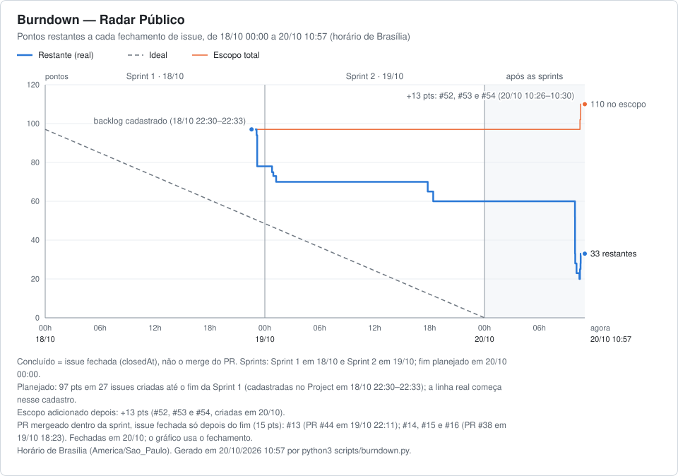

# Burndown

Gerado em 20/10/2026 12:39 (horário de Brasília) a partir do GitHub Project [Radar Público](https://github.com/users/cerfdotdev/projects/12). Para atualizar, rode `python3 scripts/burndown.py` na raiz do repositório.

## Pontos por sprint

| Sprint | Período | Planejado | Adicionado depois | Concluído na sprint | Concluído após o fim | Em aberto | Fechado sem conclusão |
|---|---|--:|--:|--:|--:|--:|--:|
| Sprint 1 | 18/10 | 41 | 0 | 19 | 21 | 0 | 1 |
| Sprint 2 | 19/10 | 56 | 13 | 0 | 68 | 0 | 1 |
| **Total** |  | **97** | **13** | **19** | **89** | **0** | **2** |

Planejado: issues criadas até o fim da primeira sprint. Concluído na sprint: fechada antes do fim dela; após o fim: fechada depois. Em pontos (campo Pontos).

## Pontos por responsável

| Responsável | Atribuídos | Concluídos | Concluídos dentro da sprint |
|---|--:|--:|--:|
| @cerfdotdev | 55 | 53 | 19 |
| @joaoarenda | 32 | 32 | 0 |
| @Alisson-dutra | 23 | 23 | 0 |

## Notas

- Concluído = issue fechada (closedAt), não o merge do PR. Sprints: Sprint 1 em 18/10 e Sprint 2 em 19/10; fim planejado em 20/10 00:00.
- Planejado: 97 pts em 27 issues criadas até o fim da Sprint 1 (cadastradas no Project em 18/10 22:30–22:33); a linha real começa nesse cadastro.
- Escopo adicionado depois: +13 pts (#52, #53 e #54, criadas em 20/10).
- PR mergeado dentro da sprint, issue fechada só depois do fim (15 pts): #13 (PR #44 em 19/10 22:11); #14, #15 e #16 (PR #38 em 19/10 18:23). Fechadas em 20/10; o gráfico usa o fechamento.

Issues do Project (30)

| Issue | Título | Sprint | Pontos | Responsável | Criada | Fechada | Situação |
|---|---|---|--:|---|---|---|---|
| #1 | Daily — Sprint 1 | Sprint 1 | 1 | @cerfdotdev | 18/10 22:30 | 20/10 12:19 | fechada sem conclusão (NOT_PLANNED) |
| #2 | Analisar dicionário de dados (Aposentados e Carreiras/Cargos) | Sprint 1 | 3 | @cerfdotdev | 18/10 22:30 | 18/10 23:05 | no prazo |
| #3 | Modelagem do schema PostgreSQL | Sprint 1 | 5 | @cerfdotdev | 18/10 22:30 | 18/10 23:10 | no prazo |
| #4 | Carga e tratamento dos dados (ETL) | Sprint 1 | 8 | @cerfdotdev | 18/10 22:30 | 18/10 23:10 | no prazo |
| #5 | Índices B-tree e pg_trgm para buscas | Sprint 1 | 3 | @cerfdotdev | 18/10 22:30 | 18/10 23:10 | no prazo |
| #6 | docker-compose com db-server, backend e frontend | Sprint 1 | 3 | @cerfdotdev | 18/10 22:30 | 20/10 10:22 | 1 d 10 h após o fim da sprint |
| #7 | Backend: Dockerfile, app Flask e Gunicorn | Sprint 1 | 3 | @joaoarenda | 18/10 22:30 | 19/10 00:47 | 47 min após o fim da sprint |
| #8 | Backend: pool de conexões e configuração por ambiente | Sprint 1 | 2 | @joaoarenda | 18/10 22:31 | 19/10 00:55 | 55 min após o fim da sprint |
| #9 | Backend: GET /api/servidores com filtros nome, cargo, uf e orgao | Sprint 1 | 5 | @joaoarenda | 18/10 22:31 | 19/10 18:23 | 18 h 23 min após o fim da sprint |
| #10 | Frontend: stack, Dockerfile e proxy para a API | Sprint 1 | 3 | @Alisson-dutra | 18/10 22:31 | 19/10 01:14 | 1 h 14 min após o fim da sprint |
| #11 | Frontend: identidade visual e tela de busca simples | Sprint 1 | 5 | @Alisson-dutra | 18/10 22:31 | 19/10 17:48 | 17 h 48 min após o fim da sprint |
| #12 | Daily — Sprint 2 | Sprint 2 | 1 | @cerfdotdev | 18/10 22:31 | 20/10 12:19 | fechada sem conclusão (NOT_PLANNED) |
| #13 | Backend: busca por similaridade (?similar= e limit até 100) | Sprint 2 | 5 | @joaoarenda | 18/10 22:31 | 20/10 09:53 | 9 h 53 min após o fim da sprint; PR #44 mergeado em 19/10 22:11 |
| #14 | Backend: paginação e metadados | Sprint 2 | 3 | @joaoarenda | 18/10 22:31 | 20/10 09:53 | 9 h 53 min após o fim da sprint; PR #38 mergeado em 19/10 18:23 |
| #15 | Backend: validação de parâmetros e erros padronizados | Sprint 2 | 5 | @joaoarenda | 18/10 22:31 | 20/10 09:53 | 9 h 53 min após o fim da sprint; PR #38 mergeado em 19/10 18:23 |
| #16 | Backend: proteção contra SQL injection | Sprint 2 | 2 | @joaoarenda | 18/10 22:31 | 20/10 09:53 | 9 h 53 min após o fim da sprint; PR #38 mergeado em 19/10 18:23 |
| #17 | Backend: timeout de busca | Sprint 2 | 2 | @joaoarenda | 18/10 22:32 | 20/10 09:53 | 9 h 53 min após o fim da sprint |
| #18 | Backend: rate limiting e limite de concorrência | Sprint 2 | 5 | @joaoarenda | 18/10 22:32 | 20/10 09:53 | 9 h 53 min após o fim da sprint |
| #19 | Teste de carga paralela da API | Sprint 2 | 5 | @cerfdotdev | 18/10 22:32 | 20/10 12:38 | 12 h 38 min após o fim da sprint |
| #20 | Frontend: busca por similaridade e busca combinada | Sprint 2 | 5 | @Alisson-dutra | 18/10 22:32 | 20/10 09:53 | 9 h 53 min após o fim da sprint |
| #21 | Frontend: paginação, detalhe e estados de erro | Sprint 2 | 5 | @Alisson-dutra | 18/10 22:32 | 20/10 09:54 | 9 h 54 min após o fim da sprint |
| #22 | Desktop: app PySide6 consumindo a API | Sprint 2 | 5 | @Alisson-dutra | 18/10 22:32 | 20/10 10:03 | 10 h 03 min após o fim da sprint |
| #23 | Desktop: compilar com PyInstaller | Sprint 2 | 2 | @cerfdotdev | 18/10 22:32 | 20/10 11:58 | 11 h 58 min após o fim da sprint |
| #24 | Script de burndown a partir das issues | Sprint 2 | 3 | @cerfdotdev | 18/10 22:32 | 20/10 11:21 | 11 h 21 min após o fim da sprint |
| #25 | Relatório final | Sprint 2 | 5 | @cerfdotdev | 18/10 22:32 | 20/10 12:27 | 12 h 27 min após o fim da sprint |
| #26 | Sprint review e retrospectiva | Sprint 2 | 1 | @cerfdotdev | 18/10 22:32 | 20/10 12:27 | 12 h 27 min após o fim da sprint |
| #27 | Entrega: teste limpo e .zip da pasta projeto | Sprint 2 | 2 | @cerfdotdev | 18/10 22:33 | 20/10 12:35 | 12 h 35 min após o fim da sprint |
| #52 | Backend: completar o contrato da API (detalhe, similar com filtros) | Sprint 2 | 5 | @cerfdotdev | 20/10 10:26 | 20/10 11:14 | 11 h 14 min após o fim da sprint; adicionada após o planejamento |
| #53 | Docs: arquitetura do sistema (system design) | Sprint 2 | 3 | @cerfdotdev | 20/10 10:30 | 20/10 11:18 | 11 h 18 min após o fim da sprint; adicionada após o planejamento |
| #54 | Backend: cache das buscas | Sprint 2 | 5 | @cerfdotdev | 20/10 10:30 | 20/10 12:15 | 12 h 15 min após o fim da sprint; adicionada após o planejamento |

